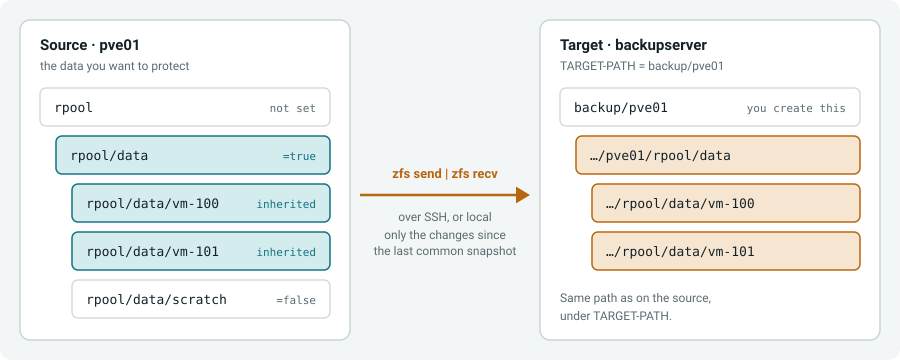
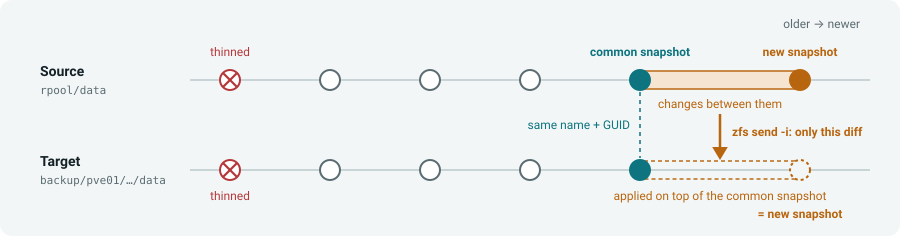
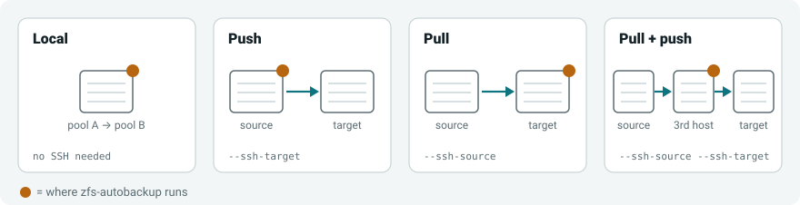

# ZFS autobackup

[](https://github.com/psy0rz/zfs_autobackup/actions?query=workflow%3A%22Regression+tests%22) [](https://coveralls.io/github/psy0rz/zfs_autobackup)  [](https://pypi.org/project/zfs-autobackup/)
[](https://github.com/psy0rz/zfs_autobackup/actions/workflows/codeql-analysis.yml)

## Introduction

ZFS-autobackup tries to be the most reliable and easiest to use tool, while having all the features.

You can either use it as a **backup** tool, **replication** tool or **snapshot** tool.

There are no config files: just test your command on the commandline and copy/paste it to a cron or script. Use
`--test` to see what it will do without changing anything, and `--debug` to see the actual ZFS commands it runs.

## How it works

Mark the datasets you want to back up with a ZFS property, and run zfs-autobackup:



After the first full backup, every run only sends the changes since the last snapshot that both sides have:



Install it on one machine only. It reaches the other side over SSH, so it works local, push, pull or pull+push:



## Features

* Works across operating systems: Tested with **Linux**, **FreeBSD/FreeNAS** and **SmartOS**.
* Low learning curve: no complex daemons or services, no additional software or networking needed.
* Plays nicely with existing replication systems. (Like Proxmox HA)
* Creates consistent snapshots. (takes all snapshots at once, atomically.)
* Also supports complex backup geometries.
* ZFS encryption support: Can decrypt / encrypt or even re-encrypt datasets during transfer.
* Supports sending with compression. (Using pigz, zstd etc)
* IO buffering to speed up transfer.
* Bandwidth rate limiting.
* Multiple backups from and to the same datasets are no problem.
* Replicates clones, and keeps the clone relationship on the target.
* Resilient to errors.
* Ability to manually 'finish' failed backups to see what's going on.
* Uses progressive thinning for older snapshots.
* Uses bookmarks and holds to protect the snapshots it needs.
* Automatic resuming of failed transfers.
* Easy migration from other zfs backup systems to zfs-autobackup.
* Gracefully handles datasets that no longer exist on source.
* Complete and clean logging.
* Includes zfs-autoverify and zfs-check to verify your backups.
* All code is regression tested against actual ZFS environments.
* Easy installation:
    * Just install zfs-autobackup via pip.
    * Written in python and uses zfs-commands, no special 3rd party dependencies or compiled libraries needed.

## Getting started

```sh
pip install zfs-autobackup
```

Please look at our wiki to [Get started](https://github.com/psy0rz/zfs_autobackup/wiki).

Or read the [Full manual](https://github.com/psy0rz/zfs_autobackup/wiki/Manual).

## Sponsor list

This project was sponsored by:

* https://rsync.net
* [DatuX](https://www.datux.nl)
